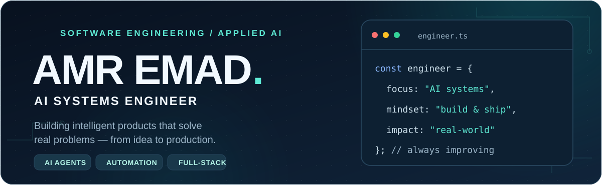

<picture>
  <source media="(prefers-color-scheme: dark)" srcset="./assets/hero-dark.svg">
  <source media="(prefers-color-scheme: light)" srcset="./assets/hero-light.svg">
  
</picture>

### Hey, I'm Amr 👋

I'm a software engineer focused on **AI systems, intelligent automation, and full-stack products**.

I enjoy turning complicated problems into practical software — connecting language models, business workflows, APIs, and thoughtful interfaces. My focus is on **building things people can actually use**, not just impressive demos.

- 🧠 **Applied AI:** AI agents, retrieval-augmented generation (RAG), conversational systems, and speech interfaces.
- ⚙️ **Engineering:** Backend architecture, API integrations, automation, and dependable delivery.
- 🚀 **Product mindset:** From prototype and user experience to deployment and iteration.
- 🌍 **Based in Egypt · Building for the web.**

---

### ⚡ Things I've built

<table>
<tr>
<td width="50%" valign="top">

**[💬 Embeddable AI Chat Widget](https://github.com/amrpyt/simple-chat-widget)**

A customizable, responsive chat widget that connects websites to **n8n** workflows.

[Source code](https://github.com/amrpyt/simple-chat-widget) · [Live demo](https://chat-widget.coderaai.com/)

</td>
<td width="50%" valign="top">

**[🧠 Multimodal AI Platform](https://github.com/amrpyt/Graduation-FCAI-V2)**

A modular project combining **face recognition, speech-to-text, and RAG** with API integration.

[Explore the architecture](https://github.com/amrpyt/Graduation-FCAI-V2)

</td>
</tr>
<tr>
<td width="50%" valign="top">

**[🎬 YouTube Transcript API](https://github.com/amrpyt/youtube-transcript-api-project)**

A self-hosted **FastAPI** service for video transcripts, packaged with **Docker** and API documentation.

[Source code & setup](https://github.com/amrpyt/youtube-transcript-api-project)

</td>
<td width="50%" valign="top">

**[🏥 Medical Booking Experience](https://github.com/amrpyt/elshefa-clinic-booking)**

A bilingual **React** booking interface with doctor search, appointment flows, and admin screens.

[Explore the project](https://github.com/amrpyt/elshefa-clinic-booking)

</td>
</tr>
</table>

**Also building:** [CoderaAI](https://coderaai.com/) — practical AI agents and business automation solutions.

---

### 🛠️ My toolkit

**Languages & product development**

**AI, APIs & automation**

---

### Have an interesting problem to solve?

**Let's turn it into something useful.**

[**Portfolio**](https://amr-portfolio-psi.vercel.app/) · [**LinkedIn**](https://www.linkedin.com/in/amr-emad-el-khouly-344a6022b/) · [**CoderaAI**](https://coderaai.com/)

Curiosity → Architecture → Build → Ship → Improve

